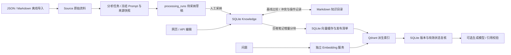

# ARCHITECTURE.md

## 当前架构总览（2026-10-18，应用 `0.8.0` / 数据库 `0006`）

本节是维护入口。后面的版本说明和原始蓝图保留为历史记录；其中“当前版本”“RAG 关闭”“单来源”等表述只适用于对应发布时点，不能替代本节。当前范围是本机个人知识管理、离线知乎导入、可选模型整理和知识笔记检索问答，不包含在线知乎抓取、账号登录、多用户或多轮问答历史。

### 实际分层与入口

| 层次 | 当前职责和主要代码 |
| --- | --- |
| 网页 | 同源 HTML/CSS/模块化 JavaScript、Hash 路由；资料、笔记、分析任务、草稿、Prompt、问答和设置各自组织。仅发布指定资源目录，见 [`app/web/routes.py`](app/web/routes.py) 与 [`app/web/`](app/web/) |
| API | 请求校验、分页投影、错误映射与配置写入保护，见 [`app/api/`](app/api/)；[`app/main.py`](app/main.py) 的 `create_app` 装配服务及生命周期 |
| 业务服务 | 内容与来源关联、逐条导入、模板与持久批次、同步、索引、引用回答分别编排，见 [`app/services/`](app/services/)；不把模型等待放入数据库事务或内容同步锁 |
| 持久化 | [`app/models/`](app/models/) 定义实际记录，[`app/repositories/`](app/repositories/) 提供短事务查询；显式 Alembic 迁移位于 [`migrations/versions/`](migrations/versions/) |
| 模型与向量 | [`app/agents/`](app/agents/) 适配四类文本生成协议；[`app/vector/`](app/vector/) 分离 Embedding、确定性分块与 Qdrant REST；固定协议提示词位于 [`app/prompts/`](app/prompts/) |
| Windows 宿主 | [`app/desktop/`](app/desktop/) 管理资源/运行目录、WebView2、本机随机端口、单实例、备份升级及优雅重启；固定使用 `dist/PersonalAiMemoryOs-0.6.6/`，目录名不是应用版本 |

Source 原文、处理草稿与 Knowledge 是不同业务对象。只有已保存且有效的 Knowledge 参与索引；采纳不是隐式自动操作。笔记通过有序关联表支持最多 20 个来源，兼容字段 `source_id` 始终投影首个来源；同标题资料的分组只是列表投影，不合并 Source 身份。

Prompt 模板分 `knowledge` 与 `rag_qa` 两种用途，各有默认模板和不可变修订。独立 Prompt 页面修改模板后立即供新请求选择；任务冻结当时模板、模型配置和生成参数。生成任务与草稿页面分别展示调度进度和已保存结果。批次重启后暂停，取消只阻止后续调用；未知调用结果不能自动付费重试。见 [`prompt_templates.py`](app/services/prompt_templates.py)、[`processing_batches.py`](app/services/processing_batches.py) 和 [`processing_batch_store.py`](app/services/processing_batch_store.py)。

### 权威数据、同步和一致性边界

- **SQLite 保存业务身份、版本、来源关系、草稿和索引发布依据；Markdown 是可编辑入口。** 双方以 `sync_states` 的共同基线做三方比较，无法自动合并时保存双方快照，由用户选择；不能只用文件时间覆盖数据库。
- **SQLite、Markdown 与 Qdrant 之间没有分布式事务。** 文件副作用先保存 `sync_operations`，用原始文件哈希和版本核验、同目录替换及重启恢复协调；目录缺失或扫描失败不得推断为批量删除。见 [`sync_reconcile.py`](app/services/sync_reconcile.py)、[`sync_operations.py`](app/services/sync_operations.py)。
- **Qdrant 是可重建的派生存储。** 成功向量先入 SQLite，再上传属于本应用代次的 collection，重新核验笔记后条件发布；查询命中回查 SQLite，排除未发布、过期、删除、开放冲突或同步错误内容。文件移动只更新引用路径，不重新编码。见 [`rag.py`](app/repositories/rag.py)、[`rag_index_jobs.py`](app/services/rag_index_jobs.py)、[`rag_search.py`](app/services/rag_search.py)。
- 未知或中断的 Embedding 调用须显式重试；已有缓存的 Qdrant 写入可以恢复。切换模型、revision、维度或分块规则需显式重建。索引不完整和服务故障分别报告，不能当成“知识库为空”。
- 问答只使用本轮核验片段，固定 JSON/引用合同不能被自定义 Prompt 取消；生成后再次校验上下文，变化则返回 `409 context_changed`。没有片段时不调用生成模型。引用可追溯不等于模型结论已通过真实性审阅。

### 进程、服务与配置边界

当前支持 **一个存储对应一个应用进程、一个 Uvicorn worker**。[`app/main.py`](app/main.py) 的 `RLock`、[`GenerationGate`](app/agents/generation_gate.py) 及后台协调器均是进程内设施；[`Dockerfile`](Dockerfile) 固定 `--workers 1`。桌面互斥锁按便携目录区分，不能约束另一个本机/Docker 进程使用同一数据库和知识目录。不得对同一存储同时启动两种运行方式，也不能用增加 workers 直接扩容。多进程支持需要另外设计跨进程锁、任务归属和调度协调，尚未实现。

AI 与 RAG/Embedding 分别配置，默认发行配置均关闭。网页保存模型设置只更新下次启动配置，连接测试由用户显式发起；模板修改则立即供新任务使用。配置写入有同源、令牌、revision 和文件恢复日志保护，运行时环境变量优先，Compose 配置只读。见 [`ai_settings.py`](app/services/ai_settings.py)、[`rag_settings.py`](app/services/rag_settings.py)、[`configuration_files.py`](app/services/configuration_files.py)。这不是账号认证体系，应用仍限定本机使用。

已配置的 Windows 桌面可在双击时自动准备外部本地服务：[`local_services.py`](app/desktop/local_services.py) 读取便携目录的可选 `config/local-rag-startup.json`，只对已开启 RAG 且使用预期本机地址的配置调用随包提供的 [`start_local_rag.ps1`](scripts/start_local_rag.ps1)。它使用配置指向的项目目录中已安装的 Ollama、Docker Desktop 与 Compose Qdrant；**不内置模型、Docker 或 Qdrant，不自动下载权重，也不随窗口退出停止共享服务**。准备失败可明确选择本次关闭 RAG 继续基础管理；保存配置保持不变。整个便携目录移动后，外部项目路径及服务依赖仍需单独核对。

当前这台电脑已部署 Ollama `0.40.6` / BGE-M3 1024 维和 Qdrant `1.19.2`，固定便携安装已开启 RAG；最近交付审计为 2 篇笔记已发布、0 失败，隔离生命周期、少量真实本地检索及桌面重启验证通过。新发行包仍保持默认关闭。这些是已记录的验收结果，不是对实时状态或所有问题检索质量的保证；**DeepSeek 真实生成审阅及完整真实引用问答质量验收仍待完成**。详见 [任务记录](IMPLEMENTATION_TASKS.md) 与 [RAG 指南](docs/rag-guide-cn.md)。

## 历史版本记录与原始蓝图

以下按原发布记录保留，涉及行为和状态时须以对应版本为范围。

## v0.8.0: Prompt Center, Draft Workspace, Pagination and RAG Setup

Application `0.8.0` uses explicit schema `0006`. Engineering acceptance and the fixed-directory delivery are complete; historical release results below remain unchanged evidence. Real-provider quality is a separate pending gate.

The workspace separates AI analysis submission/progress, saved draft browsing/detail and Prompt management into independent routes. Draft lists use small read-only projections; full source snapshots, model output and proposal Markdown are loaded only on detail access. Adoption remains explicit and keeps existing optimistic freshness, multi-source provenance and idempotent-note rules. Source and draft records do not become retrieval content without a saved Knowledge note.

Prompt templates and immutable revisions now have `purpose=knowledge|rag_qa`. Each purpose owns an independent default; the full eight-stage analysis and existing edited templates remain knowledge templates. A separate cited-answer template may customize answer style, emphasis and structure. The fixed answer JSON/evidence/citation contract remains outside user-editable instructions. Requests freeze the selected revision before any remote wait. Cross-purpose selection is rejected; historical v1/v2 processing snapshots remain readable.

All record-list controls converge on 10/20/50/100 items, numbered navigation, direct page entry and separate state for each list. The API continues bounded offset/limit semantics. Summary-only draft, template/revision, synchronization and index status reads avoid repeatedly loading bodies or error snapshots. Full details remain independently available. Import-report and search-result pagination operates on already obtained results and must not repeat imports, Embedding calls or answer generation. The analysis selection limit stays 20 regardless of visible page size; note bodies are not paginated or truncated.

`/api/v1/settings/rag` owns next-start RAG/Embedding configuration alongside the existing AI settings service. The runtime registry remains immutable until an explicit restart. Shared configuration locking, a full-file revision, contained two-file journal commit and mutual AI/Embedding YAML path protection preserve unrelated `.env` values and prevent lost updates. Credentials are write-only shared references; read responses include configured/environment-managed flags, not values. Docker read-only settings and process-environment precedence remain authoritative.

Local preflight, Qdrant connectivity and Embedding connectivity are separate states. Saving or reading settings never calls a model, creates a collection or updates an index. The explicit test endpoint checks saved-revision configuration: Qdrant uses a read-only version GET; Embedding requires a separate confirmation and makes one fixed-text call with no retry. Probe concurrency is limited and errors are sanitized. Local readiness does not assert network connectivity, retrieval quality or model availability. Default RAG remains off and no production Embedding provider is selected by this work.

The existing Knowledge-only index architecture, 1.19.x Qdrant client, SQLite-authoritative publication and source/Markdown freshness rules remain in force. Visual setup does not bundle a model/Qdrant process or grant implicit real-call permission. Full regression passed 1,088 checks/3 Windows skips, with local/Docker browser, final frozen-EXE restart and old-to-new migration acceptance. The fixed installation was backed up and reopened, preserving its 571 Sources, 2 notes, 3 runs, 1 batch, private configuration and full vault. RAG remains off. Evidence and precise mock/real boundaries are recorded in `IMPLEMENTATION_TASKS.md`.

Program upgrades use short exclusive sibling temporary files for atomic replacement and rollback, alongside numbered, hash-verified backups. This avoids the Windows long-path failure reproduced in the first isolated upgrade without changing business-data paths or overwriting unknown files.

Real isolated local and Docker HTTP workflows now also pass against Qdrant `v1.19.2` with offline model endpoints: custom QA template identity/hash, concurrent-edit revision freezing, cross-purpose rejection, literal citations and the Knowledge-only edit/delete/restore/restart lifecycle. Evidence `.cache/v08-rag/f61cb47e7d2044539184c58ed8509154/report.json` confirms no remaining owned containers/networks/volumes and unchanged formal storage. This validates engineering integration, not real-provider answer quality.

## v0.7.0: Prompt-Selected Processing Workspace and Safe Portable Continuity

Implementation and engineering acceptance are complete. Application `0.7.0` uses explicit schema `0005`; the historical release sections below remain evidence of earlier behavior.

The AI workspace replaces the single select with a paged, title-searchable Source selection area, current-page selection, retained cross-page UUID/version selection and lazy body previews. Individual mode produces one run per Source; merged mode produces one combined run for up to 20 selected Sources. Loaded versions and distinct identities remain authoritative even for equal titles. Preview uses existing safe content rendering rather than loading every full body into a selector. Generation/status controls share a coherent toolbar; successful Knowledge save returns to the overview.

Prompt templates are business records, separate from model-provider settings and secrets. A dedicated API/service manages editable templates, a default selection, archive state and immutable revisions. The user's full eight-stage Zhihu analysis instructions are the new default resource, while the legacy knowledge-v1 template remains available. Runs/batches freeze template text/version/hash and a separate output/capability contract, so editing a template never changes earlier analysis. The original instructions are not reduced to an eight-field summary.

The generation boundary supports historical JSON v1 and JSON v2 containing metadata, complete Markdown body and exact selected-source quotations. V2 adoption copies the complete body into Knowledge. Multiple Source snapshots drive freshness checks; adoption writes the note, all ordered associations and the run's adoption relation atomically. Existing `source_id` fields remain first-source compatibility projections. Sources, drafts and temporary model text never become searchable Knowledge merely through generation.

Persistent batch storage owns ordered inputs, idempotent submission, per-item attempt/run identity, pause/continue/retry/cancel and restart recovery. The batch coordinator acquires the existing process-wide text-generation gate per call; drafts and cited question answering share that slot. Model waits occur outside SQLite transactions and the synchronization mutation lock. Pending work is not automatically replayed after restart, and unknown paid outcomes require explicit retry. Shutdown must stop dispatch before draining the current call and releasing database resources.

The provider adapters remain text-generation transports without a browsing/tool execution loop. The selected Prompt may ask for external verification, but runtime capability instructions must state that web verification is unavailable and distinguish unverified external knowledge from the supplied material. The application must not invent fetched sources. Explicit per-generation output/timeout overrides are frozen in run/batch metadata; no truncation repair, implicit budget escalation or automatic paid retry is added.

`KnowledgeSource` provides ordered many-to-many provenance while retaining the legacy primary link. Content services enforce unique active sources, optimistic versions, all-source deletion/restore constraints and complete associations in list/detail projections. Markdown v1 hashes and old files stay unchanged; multi-source v2 participates in ordinary identity backfill, conflict comparison, deletion/restoration and operation replay. RAG reads SQLite and extends hit/citation metadata without placing source association/path metadata in vector text.

Settings saving continues to commit next-start configuration only. A separate, same-origin/token-protected desktop action offers an explicit immediate restart or later exit; ordinary Python/Docker cannot restart themselves through this action. The portable successor signals readiness and waits on the exact original process handle before taking the per-directory instance mutex and opening storage. Dirty checks and graceful in-flight draining precede exit; configuration/model traffic is never replayed by the restart mechanism.

Delivery uses a verified program-file manifest and in-place resource replacement in the selected existing portable directory. Only declared EXE/`_internal`/public instruction/manifest resources are managed; runtime `.env`, personal YAML, SQLite, knowledge, logs and unknown files are preserved. Full backup/hash checks, stopped-instance ownership and recovery handling precede resources/schema changes. The fixed used directory `PersonalAiMemoryOs-0.6.6` may contain application `0.7.0`; the directory name is not the version. Staging/acceptance stays in project `.cache`, rather than creating another versioned user installation. Public changes receive local Git commits; private runtime files are excluded.

Validation: 1,030 tests/3 Windows skips/1 existing warning passed, alongside real local browser, frozen EXE, blocked-call restart and same-directory old-version migration workflows. The fixed portable installation was backed up, upgraded and reopened with data/configuration retained; evidence is recorded in `IMPLEMENTATION_TASKS.md`. TASK-004/005 real model quality gates are unchanged, and simulated success does not certify providers.

## v0.6.6 Visual AI Settings

Settings is a dedicated hash route below the upper-left brand, directly reachable from the mobile top bar and native desktop Settings menu. Browser modules separate the page lifecycle/API controller, global/profile editor, protocol-specific fields and local provider templates. Existing dirty-navigation and desktop-close guards remain authoritative; the native menu changes the hash rather than reloading the window. Data, database, Knowledge and configuration locations are a read-only projection of the current runtime. There is no path-edit API or Embedding/RAG editor.

`GET /api/v1/settings/ai` returns revision, desired non-secret profiles, configured/environment-managed key flags, paths, restart state and a process-scoped configuration token. `PUT` accepts the expected revision, complete profile list, desired AI/default switches and write-only key updates. The loopback Host/origin/token guard rejects cross-origin writes; settings responses, including errors, use no-store headers. Strict bounded input validation emits safe field locations/types without rejected credentials. Browser errors display fixed messages, and secrets never enter URLs, browser storage, response payloads or reports.

The service validates all four existing protocols and preserves advanced fields. Process environment overrides remain authoritative; managed fields/keys cannot be overwritten, and Compose marks settings read-only. Empty key input leaves stored keys intact; shared references update once. `.env` and provider YAML are committed through contained, hash-checked, recoverable file operations with a private configuration journal. Configuration I/O stays outside the event loop and never changes SQLite, Knowledge or current provider registries. Recovery files may contain credentials and are not published as web assets or packaged personal data.

The running AI registry remains fixed for its lifetime. Saving modifies only the next-start configuration, returns `restart_required`, and makes no provider request, hot reload, RAG change or automatic restart. The browser clears password fields/request-key references after saving or disposal, preserves local inputs on 409 until confirmed reload, and ignores disposed/changed routes. A response arriving during the unsaved-navigation confirmation waits for its outcome so cancelling departure cannot strand the form. Version `0.6.6` retains schema `0004` without a migration. The environment editor directly imports `python-dotenv`, so this already-installed transitive package is now an explicit runtime dependency; the lock remains at 47 packages without a new wheel, provider SDK or framework.

Engineering acceptance passed: 925 tests/3 Windows symlink skips/1 existing warning, 30 ESM modules, six synthetic-API Chromium groups and a real isolated local API/Chromium save/restart check. Actual frozen settings acceptance also passed (`.cache/ai-settings-validation/cc980ee5477944138fdbc946a39a2d5d/report.json`), including restart-loaded key/profile readiness, unchanged business rows and cleaned successful credential journals. Local/frozen traps received zero endpoint requests; readiness is not real-provider acceptance. Frozen grouped-reading/sorting regression and the complete 17-flow desktop workflow passed, including graceful mock-call drain and native invalid-configuration feedback (`.cache/desktop-validation/2042177c88c04b149202973303f02499/report.json`). The audited separate portable build preserves older releases and formal Docker 0.6.0; TASK-004/005 real quality and existing production Save As/second-PC boundaries remain unchanged.

Final owned-resource cleanup passed (`.cache/desktop-066-cleanup.json`): no desktop process remains, four validation ports are closed, the distribution is pristine and older artifact/formal-storage hashes are unchanged.

## v0.6.5 Source Group Sorting

The existing group projection accepts validated `sort_by=title|source_count|source_type|updated_at` and `order=asc|desc`, defaulting to latest update descending. SQL applies state/keyword filters, groups the complete result, then sorts and paginates; sorting never acts only on a browser page. A fixed column map prevents arbitrary ORDER BY expressions. Title ascending breaks ties consistently. Source type is the minimum visible `Source.source_type` within a group, preserving arbitrary strings without delimiter aggregation. The response shape and legacy/member APIs stay compatible; no schema migration or body hydration is introduced.

The Source list shares sorting controls and accessible sortable headings with one hash state. Sort changes reset pagination, while filtering, page-size changes and nested editor return links retain sorting. Existing request-disposal/hash guards and safe rendering remain in effect. Version0.6.5 uses schema0004 and no new dependency.

## v0.6.4 Source Title Groups and Pagination

The workbench adds read-only title-group projections in the existing API/service/repository layers. `/api/v1/ui/source-groups` filters before grouping and paginating the complete dataset; totals distinguish title groups from individual Sources. Exact stored title equality defines membership. `/api/v1/ui/source-groups/items` returns bounded member summaries and existing Source detail endpoints provide full bodies on demand. No persistent group entity or data merge is introduced. Active/trash/all filtering applies to both group counts and membership; the flat API remains compatible.

Separate source-list and group-reading controllers share an accessible numbered pager. Hash parameters retain filters, page size and position, while editor return context preserves list/group navigation. Requests are cancellable and stale responses cannot replace another view. Group bodies use the existing safe Markdown renderer with bounded parallel detail reads; exceptionally large content remains available as full plain text. Individual optimistic versions, edits, source identities, Knowledge links and draft generation remain unchanged. Version 0.6.4 uses schema0004 and no new dependency.

## v0.6.3 Offline Markdown Collection Import

The browser/WebView2 reads explicitly selected Markdown files, ignores directory indexes/non-text media and uploads relative display names plus content through a bounded JSON endpoint. Client paths never authorize backend filesystem reads. The Markdown export adapter safely separates YAML metadata from the unmodified body and maps into existing `ParsedZhihuItem`; `ImportService` remains responsible for short per-item transactions, identity uniqueness, dry-run simulation, difference reporting and partial failures. Pins use their own identity type with normalized `/pin/{id}` links and legacy URL matching.

The new endpoint permits 1,000 files/10 MiB; legacy JSON remains 500/10 MiB. A distinct report projection adds file metadata without exposing raw bodies or changing the old JSON response. Selection freezes request bytes across preview/commit and invalidates on mode/file changes. Imports never create Knowledge, touch the Markdown vault, transfer images or invoke models. No migration or dependency is added. Desktop delivery needs the complete updated executable/backend rather than a frontend-only patch.

## v0.6.2 List Selection and Toolbar Layout

`knowledge-selection.js` owns current-page selection, confirmation, ordered per-note soft-delete submissions and partial-result presentation. It uses the loaded versions with existing DELETE endpoints; no all-or-nothing transaction or automatic retry is implied. Unknown/server failures halt unsubmitted requests. The content-list controller resets selection on filtering/pagination and disables stale controls while loading. Deleted rows are ineligible. Summary reads, backend services and schema remain unchanged.

Search retrieval controls use scoped toolbar styles rather than changing the shared vertical form-field layout. Patch releases can publish to a new portable basename without replacing a used installation. Backed-up static resources remain backward-compatible with the existing 0.6.1 APIs.

## v0.6.1 Portable Windows Host

The desktop entry point embeds the unchanged FastAPI/UI in a pywebview EdgeChromium window. PyInstaller onedir packaging includes Python, static assets, prompts, migration scripts and configuration templates; desktop/build dependencies are separate from API/Docker runtime dependencies. No new tables or public API are introduced; schema stays `0004`. The formal v0.6 Compose service is not redeployed by desktop delivery.

Resource and runtime roots are distinct: bundled resources are immutable package files, while the portable executable directory owns `.env`, provider configuration, SQLite, the paired Markdown vault, WebView storage and rotating logs. Desktop-only bootstrap enforces contained resolved paths and refuses missing existing-vault identity, unknown schema and unsupported newer revisions. New empty storage initializes automatically; a supported older revision requires explicit UI consent plus a verified database/full-vault backup before migration. Source/Docker migration policy remains explicit.

The backend binds a preallocated dynamic loopback socket in the same process. A root-specific Windows mutex/event provides single-instance activation without a control HTTP API. Native window closure dispatches a CSP-safe event to the existing dirty-form guard, then prevents new interaction, stops new index batches immediately and drains current HTTP requests and the ASGI lifespan before releasing the socket and mutex. Long draining continues with visible status rather than a timed forced kill. External links open the default browser; downloads remain local. Production launches clear remote-debugging overrides; CDP is enabled only for explicit isolated test mode.

Frozen acceptance copies the pristine bundle under project cache, strips Python/uv/Docker from its PATH, attaches Playwright to the actual WebView2 window and tests native close, duplicate activation, file operations and relocation. Formal-storage hashes and no-live-provider boundaries remain mandatory. Clean-machine and real-model quality acceptance are separate from these local engineering checks.

The final Windows GUI EXE passed on 2026-10-17 against actual WebView2 155; report `.cache/desktop-validation/08a46b518be848cfb14bc89742a6e1bd/report.json` fingerprints the tested binary and unchanged formal storage. Native dirty-close cancellation, graceful provider drain, independent initialization, restart/relocation, file import/report export and Chinese path-error dialogs passed without page script errors. Full regression passed 696 tests (three Windows symlink skips, one existing warning), followed by final targeted/runtime checks; source and Docker process regressions also passed. This delivery does not modify the healthy formal 0.6.0 Docker deployment or satisfy either real-provider quality gate.

## v0.6 Local Management Workspace

The Chinese workspace is served from `/` by the same FastAPI application, with package-local static assets under `/assets` and browser hash routes. Only `app/web/` is published. Existing `/api/v1`, `/docs` and `/health` remain unchanged. There is no frontend build pipeline, second web service, login or new migration; application version is `0.6.0`, schema is `0004`, and the deployment continues binding localhost only.

Browser modules separate navigation, API requests, shared safe DOM/Markdown helpers and business pages. Existing services retain mutation/versioning/relationship/concurrency rules. Three read-only UI endpoints provide overview counts and paged Source/Knowledge summaries without large bodies; repository queries implement literal title filtering and active/deleted/all state. Detail views lazily use existing contracts. Configuration/key material is never exposed by the UI.

Dirty-input guards and optimistic-version comparison preserve local edits; status polling is visibility-aware and never refreshes editor fields. Import preview/submit share the selected bytes. Model and index requests are explicit, gated while submitting and never automatically retried. Draft adoption, conflict resolution and paid retry/rebuild continue through backend checks. Marked plus DOMPurify are pinned and vendored locally; all ordinary text uses safe DOM insertion, raw HTML/external images are disabled, unsafe link schemes are stripped and oversized bodies pause preview without truncating saved text.

Python Playwright is a development-only dependency; browser binaries/evidence stay in `.cache`, while the production image only needs the local static assets. Local/Docker acceptance uses real isolated Qdrant plus offline models, retained screenshots and console records, formal-storage fingerprints and owned-resource cleanup. Browser engineering acceptance cannot satisfy the pending real-provider quality gates of TASK-004 or TASK-005.

Engineering verification passed on 2026-10-17: 655 automated tests (two Windows privilege skips and one existing warning), both earlier regression modes, isolated local/Docker Chromium/Qdrant workflows/restarts and focused race safeguards. Final browser report `.cache/v06-validation/f685f6759bea49f99519b873d2dbbdbb/report.json` preserves unchanged formal hashes and clean owned-resource removal. Browser profiles/driver temporaries/downloads remain beneath project cache, with no real model calls. `scripts/check_web_modules.py` optionally checks explicit ESM syntax through development Node without introducing a frontend build/runtime requirement.

Formal v0.6 is deployed after a verified full stopped-service backup, with schema `0004` unchanged. The non-root loopback service is healthy, seven business/index tables remain empty and vault hashes unchanged. AI/RAG stay off and formal Qdrant stays stopped. Result `.cache/v06-deployment-result.json` records the backup and deployment checks; real-model acceptance remains separate.

All seven formal pages passed a read-only Chromium smoke without script errors or writes (`.cache/v06-formal-browser/report.json`). Production image inspection confirmed local licenses are present and Playwright/`.env` absent; validation resources were fully removed.

## 原始系统蓝图（历史设计，非当前已实现组件清单）

    Data Sources

    ↓

    Collector

    ↓

    Raw Data

    ↓

    Knowledge Processing Agent

    ↓

    Knowledge Storage

    ↓

    Vector Database

    ↓

    AI Assistant

## Core Components

### Collector

Imports external information.

### Knowledge Agent

Creates: - summary - tags - concepts

### Opinion Agent

Extracts viewpoints.

### RAG

Provides semantic retrieval.

## Technology

Backend: Python + FastAPI

Database: SQLite first, PostgreSQL later

Vector: Qdrant

Storage: Markdown + YAML

## v0.5 Semantic Retrieval and Cited Answers

The retrieval path is `committed Knowledge → deterministic chunks → independent Embedding API → SQLite vector cache → owned Qdrant collection → SQLite-validated search → cited answer`. Source text and unadopted processing runs never enter this path. Source is returned only as citation metadata.

`app/vector` owns Embedding configuration/transport, chunking and the small Qdrant REST client; repositories own durable index state, services own reconciliation/search/answer orchestration, API modules validate requests, and the question-answer prompt remains a separate versioned file. Existing HTTPX and PyYAML suffice; no vendor SDK, vector framework or local model download is added. Four existing generation protocols also serve ask requests.

SQLite remains authoritative. Background reconciliation observes committed Knowledge every five seconds, independent of which API/Markdown/adoption path changed it. Each remote call occurs outside the mutation lock and database transaction: snapshot briefly, request remotely, revalidate, then conditionally publish. New Qdrant chunks are complete before SQLite publishes their manifest; old points are cleaned afterwards. Query hits are checked against that published generation, current note content and eligibility, so orphan points and delayed cleanup cannot reintroduce deleted/stale notes. Moves update citation paths without re-embedding; conflicts and synchronization errors exclude a note.

Embedding configuration is separate from text generation, supports environment-backed key references and validates dimension/count/index/finite values. Chunks default to 1,200 characters with 200 overlap, with explicit note/chunk limits. Successful vectors are cached before Qdrant writes. Paid failed, unknown and interrupted requests require explicit retry; cached vector writes recover idempotently. A model/revision/dimension/chunk change requires explicit new-generation rebuild. Collection UUIDs/names and metadata establish ownership; the application never deletes or writes an unrelated collection.

Search does not require generation AI. Ask additionally requires a ready enabled generation profile, shares one global generation slot with draft processing, limits context to 12,000 characters, and validates exact quotes and current note identities. Empty context returns insufficient evidence without generation; invalid output returns 502 and changed context returns 409 without retries. No question history or business writes are added. Traceability checks do not replace real relevance/faithfulness review.

RAG is off by default and optional Qdrant failures leave existing `/health`, CRUD/import/synchronization contracts intact. Shutdown stops scheduling, drains indexing/answers and then closes resources; the API container has a 150-second grace period. Compose uses pinned Qdrant 1.19.2 under the `rag` profile, loopback-only port 6333 and a named volume. This is the agreed project-local-storage exception; SQLite, vector caches, Markdown and acceptance evidence remain project-local. Independent real Qdrant plus offline model acceptance must pass in local and container modes before recording engineering completion; actual service relevance/answer quality remains a separate pending gate.

Engineering acceptance passed on 2026-10-17: 609 tests, two Windows symbolic-link privilege skips, one existing upstream warning; both real-Qdrant/offline-model local and Docker workflows/restarts and earlier regression scripts passed. Owned containers/networks/volumes were cleaned, with unchanged formal storage during isolation. Evidence: `.cache/v05-validation/0e022cb9aae0471c8ac2b0efe3c98f32/report.json`. After a fully verified SQLite/full-vault backup, explicit `0003 → 0004` formal migration and non-root deployment passed; OpenAPI is 0.5.0, database integrity is `ok`, all business/RAG tables are empty, and vault hashes are unchanged. Formal AI/RAG remain off and formal Qdrant is not started. `.cache/v05-deployment-result.json` records deployment; real model calls remain zero, so TASK-005 real quality is pending.

## Historical v0.1 Foundation Decisions (2026-10-15)

- Python 3.12 and uv 0.13.0 are the baseline; `pyproject.toml` and `uv.lock` define reproducible dependencies. The application is not packaged; `uv sync --locked` manages its dependencies.
- `app.main.create_app(settings=None)` assembles FastAPI routes and a lifespan. The lifespan prepares and checks the database on startup and disposes its engine on shutdown.
- `app.config.Settings` loads project `.env` and `MEMORY_OS_` environment variables. Environment variables take precedence over `.env`; explicitly injected settings support isolated tests.
- `app.repositories.database.Database` owns synchronous SQLAlchemy 2.x connections. Phase 1 accepts file-based SQLite only and creates no business tables. Relative paths resolve from the project root; the default file is `data/memory.db`.
- `GET /health` performs a database query and returns 200 with `{"status":"ok","database":"ok"}`, or 503 with `{"status":"error","database":"unavailable"}`. Invalid configuration or a failed startup connection prevents service startup.
- Standard-library logging records lifecycle events and error classes without including database paths, configuration values or exception details in HTTP responses.
- Local service binding is `127.0.0.1:8000`. Docker uses one process, a non-root user, and `/app/data` bound to project `./data`; the host port is published only to `127.0.0.1:8000`.
- Local and Docker services use the same SQLite file sequentially. The default SQLite journal mode is retained; no PostgreSQL, vector or AI integration is introduced in this phase.

### Design Questions Recorded at v0.1

- Phase 2 must establish business keys, relationships, deduplication and processing states, introduce schema migrations, and define the authority and synchronization relationship between SQLite and Markdown.
- Phase 5 must define vector-index synchronization and rebuild behavior. A future PostgreSQL migration requires schema and data migration work, not only a connection-string change.
- AI prompts remain separate from code, and agents remain replaceable. Phase 1 only creates directory placeholders for these later responsibilities.

## v0.2 Knowledge Storage and Bidirectional Sync (2026-10-16)

The current version adds business tables, explicit migrations and editable Markdown. Historical v0.1 notes above describe that release; the following decisions supersede its no-business-table policy and host port 8000.

- HTTP routes under `/api/v1` validate requests; content services implement optimistic versioning, relationship rules and soft deletion; repositories own queries. The Source-to-Knowledge relationship is one-to-many and `source_id` may be null.
- Alembic is an explicit operator step. Startup checks the applied revision against the application migration head and fails on an uninitialized or outdated schema. Schema creation is never an implicit startup side effect.
- SQLite holds business records, version numbers and durable sync state. Markdown holds the editable note projection: identity, source link, title, summary, category, tags, concepts and body. A stored baseline identifies whether only one side or both sides changed; neither side unconditionally overwrites the other.
- Synchronization runs every two seconds by default. Two stable observations are required before file import. UUID identity survives moves inside the vault; missing files require repeated valid observations and the ten-second deletion grace before soft deletion.
- Conflict rows preserve the shared baseline, database snapshot/version and Markdown snapshot/content. Resolution explicitly selects database or Markdown through the API. Stale writes and stale resolution attempts must preserve newer observed content.
- Filesystem operations use durable intentions, expected hashes, temporary files and replacement. Recovery reconciles pending work after restart. Database transactions and filesystem writes are not one atomic transaction; operation state supports recovery across that boundary.
- The vault identity marker `.memory-os-vault` is paired with database sync state. Missing/mismatched roots, unsafe paths and invalid scans block destructive reconciliation. Back up the database and full vault together, including the marker.
- Ordinary editors do not acquire the application lock. Hash checks protect observed content, but the interval between the final check and file replacement cannot eliminate all editor races.
- Host access is now `127.0.0.1:18000`; Docker still binds container port 8000. Both `data/` and `knowledge/` are shared bind mounts. Containers copy the migrations and run as UID/GID 10001; migrations are executed separately before startup.

Alembic and PyYAML are runtime dependencies. AI agents/prompts, external collectors and vector retrieval remain separate future capabilities; no AI model or additional watcher dependency is required for this version.

## v0.3 Zhihu JSON Import (Accepted 2026-10-17)

- Add a JSON import boundary that validates and normalizes Zhihu records before the import service persists Source records. HTTP and CLI entry points share the same parser/service rules; they do not implement separate import behavior.
- `POST /api/v1/imports/zhihu?dry_run=true|false` supports preview and actual import. Uploaded JSON is sent through HTTP from the host; containers do not need an `imports/` bind mount.
- Import creates or recognizes Sources only. It must not automatically create or modify Knowledge, sync operations or Markdown files. AI enrichment remains Phase 4.
- Parse the project protocol `{schema_version:1, items:[{url,title,author?,content}]}` with a 10 MiB/500-item limit and strict top-level validation. Each item is independently valid or invalid; parser work performs no network or database IO.
- Import reports invalid items and distinguishes repeated records from changes. `source_origins` stores immutable provider/resource identity under migration `0002`; Source+origin use one transaction per valid new item. Repeated/deleted identities and conservative legacy matches are skipped without overwrite or restoration. A later database failure retains earlier successful commits and returns a partial report.
- The stdlib CLI `scripts/import_zhihu.py` accepts project-local `--file`, optional `--dry-run` and `--base-url`, uploads raw UTF-8 JSON, and stores full reports under `.cache/import-reports`. Containers do not read host file paths or fetch Zhihu URLs.
- v0.3 verification retains v0.2 synchronization/persistence checks and adds host HTTP preview, mixed-validity import, repeat/change/deleted-source handling and post-recreation deduplication with unchanged Knowledge/vault assertions. Local and Docker verifiers both exited 0; the full suite passed 270 tests with two Windows symlink privilege skips and one upstream deprecation warning.

## v0.4 Configurable AI Draft Processing

- The processing API coordinates Source snapshot/version checks, durable runs, a replaceable async model client, strict output validation and explicit adoption. `app/agents` separates profile loading, protocol conversion, bounded HTTP transport and prompt loading; the prompt is a versioned Markdown asset under `app/prompts`, not a Python string.
- Profiles in personal `config/ai-providers.yml` select Chat Completions, Responses, Claude Messages or Gemini GenerateContent. Several profiles can point to different models/accounts on the same service. Secrets are `SecretStr` environment/.env references, not YAML values or stored metadata. API listing exposes configuration readiness without credentials.
- HTTPX is a runtime dependency; no provider SDK/framework is introduced. All four adapters return one normalized text/usage result. Requests are non-streaming, have a total deadline and bounded response, reject redirects, and never retry, switch providers or repair invalid output automatically.
- Each generation creates a durable `processing_runs` record from an immutable Source snapshot. The remote call runs outside database transactions and the sync lock. One process admits one simultaneous generation, while existing CRUD and synchronization remain available. Leftover running records become interrupted on startup without another model call.
- A validated draft contains a frozen Knowledge proposal and structured opinions with literal source evidence. Preview writes no Knowledge/sync operation/Markdown. Source edits or deletion make the draft stale; adoption rejects it. Repeated adoption returns the existing note. The first adoption transaction creates one Knowledge and records that relationship together, then the existing syncer handles export/recovery.
- Markdown v1 and the current vault protocol remain unchanged; opinion structure is retained in the run and rendered into the adopted body. An independent Opinion table and RAG remain future stages.
- Compose mounts `config/` read-only and explicitly passes named credential variables. The image includes prompts and a provider example while excluding personal config and `.env`. AI defaults off and does not affect `/health` availability. Migration `0003` is explicit; back up the database and full paired vault before upgrading.
- Local and Docker acceptance use isolated synthetic services for all four wire protocols and the draft/adoption/export/edit/restart workflow. Actual vendor compatibility and output quality are separate acceptance evidence; TASK-004 cannot be complete based only on mocks.

v0.4 engineering acceptance passed on 2026-10-17: 422 automated tests, two Windows symlink skips, one existing upstream warning, and both local/Docker scripts exited 0. Docker uses a normal API bridge for published loopback access plus an internal model backend; the mock itself has no external network or published port. Formal revision `0003` and OpenAPI 0.4.0 are deployed after a verified full backup, with AI off, unchanged vault/empty business storage and healthy non-root synchronization. Real-model compatibility/quality acceptance remains pending.
